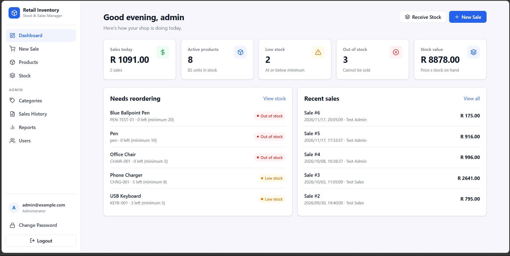
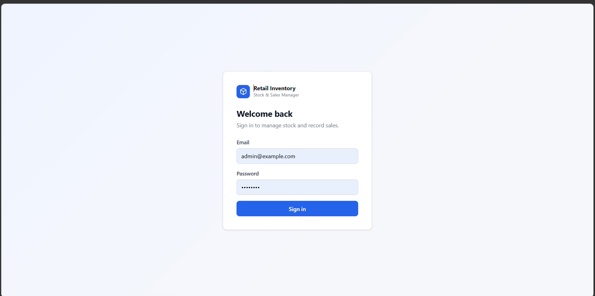
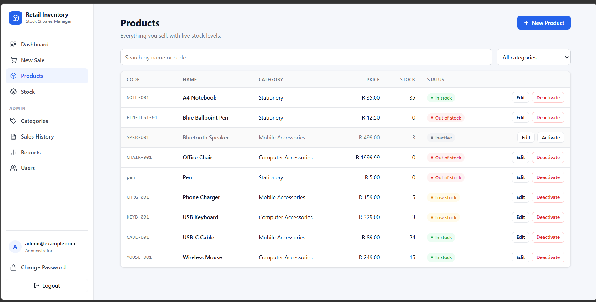
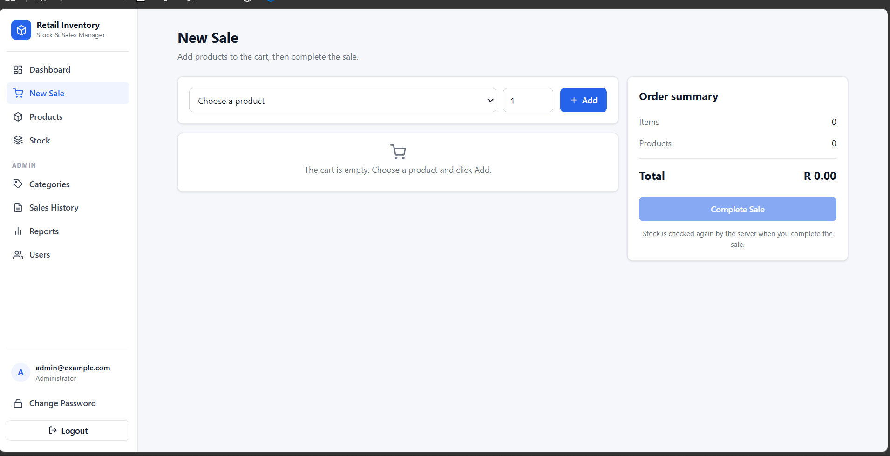
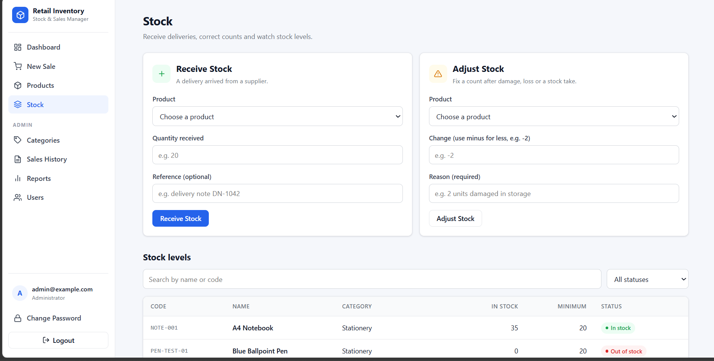
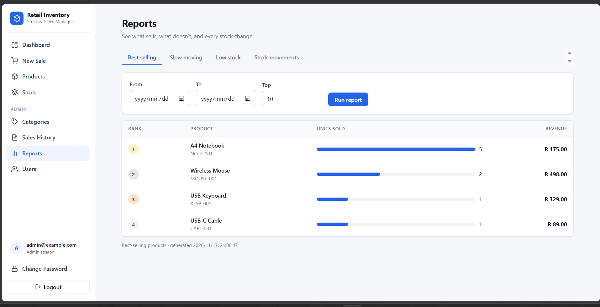
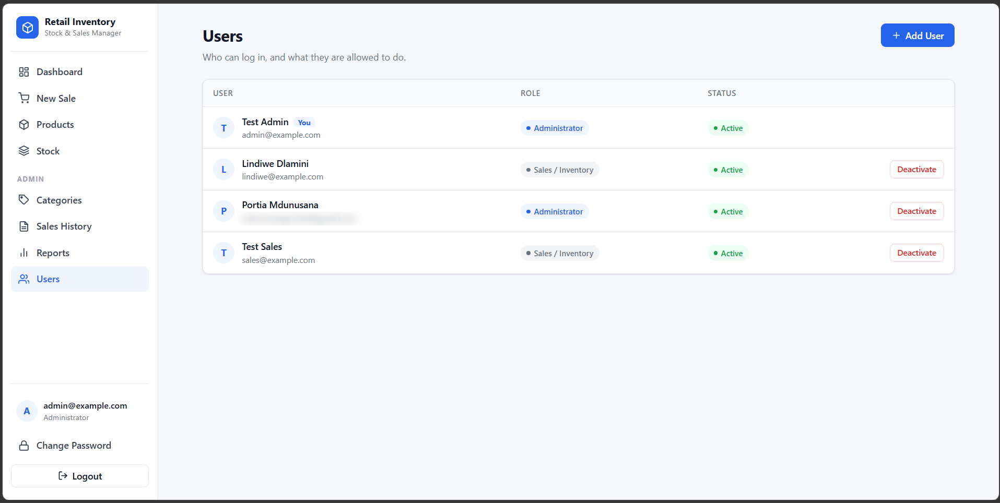

# Retail Inventory & Stock Management System

A full-stack web application that helps a small retail shop keep track of its products, stock and sales. Staff record deliveries and sales at a till screen, the system updates stock automatically, and managers get a dashboard and reports that show what is selling, what is running out, and every change to stock.

Built by **Poshia Mdunusana** as a self-directed learning project.



---

## Features

| Area | What it does |
|---|---|
| **Login and roles** | Secure login with JWT tokens. Two roles: **Administrator** (full access) and **Sales / Inventory** (day-to-day work only). |
| **Dashboard** | Today's sales, active products, low-stock and out-of-stock counts, stock value, items to reorder and recent sales. |
| **Products** | Search, filter by category, create and edit products, deactivate products without losing their history. |
| **Categories** | Add, rename and delete categories. A category that is still in use cannot be deleted. |
| **Stock** | Receive deliveries, make adjustments with a required reason, and view live stock levels with status badges. |
| **New Sale (till)** | Build a cart, see the running total, complete the sale and get a receipt with "reorder soon" warnings. |
| **Sales history** | Every sale, with the full list of items for each one. |
| **Reports** | Best-selling products, slow-moving products, low stock, and a full stock-movement audit trail with filters. |
| **Users** | Administrators create users, assign roles and deactivate accounts. Everyone can change their own password. |

## Business rules

The rules are enforced by the **backend**, not only by the screens, so they cannot be bypassed.

| Rule | Meaning |
|---|---|
| **BR01** | Every product code is unique (also checked ignoring capital letters). |
| **BR02** | Stock can never go below zero. A sale or adjustment that would do so is rejected. |
| **BR04** | A sale must contain at least one item. |
| **BR06** | A product's current stock always equals the sum of its stock movements. |
| **BR07** | Stock status is worked out from the numbers: *Out of stock* at 0, *Low stock* at or below the minimum, otherwise *In stock*. |
| Audit trail | Every stock change is saved as a movement with who made it: received (+), sale (−) or adjustment (±). Adjustments need a reason. |
| Prices | The server uses its own prices for a sale, never prices sent from the browser. |
| Roles | Only administrators can manage products, categories, users, adjustments and reports. |

Sales lock the products they touch (pessimistic locking), so two tills selling the last item at the same moment cannot both succeed.

## Technology

| Layer | Technology |
|---|---|
| Backend | Java 21, Spring Boot 4, Spring Security 7, Spring Data JPA / Hibernate |
| Security | JWT authentication, BCrypt password hashing, role-based access with `@PreAuthorize` |
| Database | MySQL 8 |
| Frontend | React 19, React Router, Vite, plain CSS design system (no UI library) |
| API docs | OpenAPI / Swagger UI |
| Testing | JUnit 5, Spring Boot Test, MockMvc, a separate MySQL test database |

## Architecture

```
React (Vite, port 5173)
        │  JSON over HTTP + JWT
        ▼
Spring Boot REST API (port 8080)
  Controller  →  Service (business rules, transactions)  →  Repository (JPA)
        │
        ▼
MySQL 8  (users, categories, products, sales, sale_items, stock_movements)
```

## Screenshots

| | |
|---|---|
|  |  |
| **Login** | **Products** |
|  |  |
| **New sale (till)** | **Receipt** |
|  |  |
| **Stock** | **Reports** |
|  | |
| **Users** | |

## Running it locally

### What you need
- Java 21 or newer
- MySQL 8
- Node.js 20 or newer

### 1. Create the database
In MySQL, run the scripts in the `database` folder in this order:

```sql
SOURCE database/01_schema.sql;
SOURCE database/02_sample_data.sql;
```

`03_verify.sql` contains checks you can run at any time, including the stock reconciliation (BR06).

### 2. Configure the backend
Create `src/main/resources/application-local.properties` (it is git-ignored, so your password is never committed):

```properties
spring.datasource.url=jdbc:mysql://localhost:3306/inventory_db
spring.datasource.username=root
spring.datasource.password=YOUR_MYSQL_PASSWORD
app.jwt.secret=ANY_LONG_RANDOM_TEXT_OF_AT_LEAST_48_CHARACTERS
```

### 3. Start the backend
```
mvnw.cmd spring-boot:run        (Windows)
./mvnw spring-boot:run          (Mac / Linux)
```
The API runs on http://localhost:8080. Swagger UI: http://localhost:8080/swagger-ui/index.html

### 4. Start the frontend
```
cd frontend
npm install
npm run dev
```
Open http://localhost:5173

### Demo logins
| Role | Email | Password |
|---|---|---|
| Administrator | admin@example.com | password |
| Sales / Inventory | sales@example.com | password |

Change these passwords after your first login (**Change Password** in the sidebar).

## Tests

```
mvnw.cmd test
```

**21 integration tests** run against a separate database (`inventory_test_db`), which is rebuilt before each run.

- **Security (10 tests):** correct and wrong logins, deactivated users blocked, requests with no token or a fake token rejected (401), sales users blocked from admin actions (403), and the tests never touch the real database.
- **Business rules (11 tests):** receiving stock logs who did it, adjustments cannot make stock negative and need a reason, sales reduce stock and use server prices, overselling and selling deactivated products are rejected, a failed sale changes nothing, duplicate product codes are rejected, and a category in use cannot be deleted.

## API overview

| Endpoint | Purpose | Role |
|---|---|---|
| `POST /api/auth/login` | Log in and receive a JWT | Public |
| `POST /api/auth/change-password` | Change own password | Any |
| `GET /api/dashboard` | Dashboard figures | Any |
| `GET/POST/PUT /api/products` | Search, create and edit products | Read: any · Write: admin |
| `PATCH /api/products/{id}/activate`, `/deactivate` | Activate or deactivate a product | Admin |
| `GET/POST/PUT/DELETE /api/categories` | Manage categories | Read: any · Write: admin |
| `GET /api/stock`, `/api/stock/low` | Stock levels | Any |
| `POST /api/stock/receive` | Receive a delivery | Any |
| `POST /api/stock/adjust` | Adjust stock with a reason | Admin |
| `POST /api/sales`, `GET /api/sales` | Record and list sales | Create: any · List: admin |
| `GET /api/reports/...` | Best-selling, slow-moving, low-stock, stock movements | Admin |
| `GET/POST/PATCH /api/users` | Manage users | Admin |

Full details are in Swagger UI while the backend is running.

## What I learned
- Designing a relational database around real business rules, and keeping derived data (current stock) consistent with an audit trail.
- Building a layered Spring Boot REST API with validation, clear error responses and transactions.
- Securing an API with JWT and role-based access, and testing that security automatically.
- Handling concurrency with database locking so stock cannot be oversold.
- Building a React front end with a consistent design system, loading states and friendly error messages.

